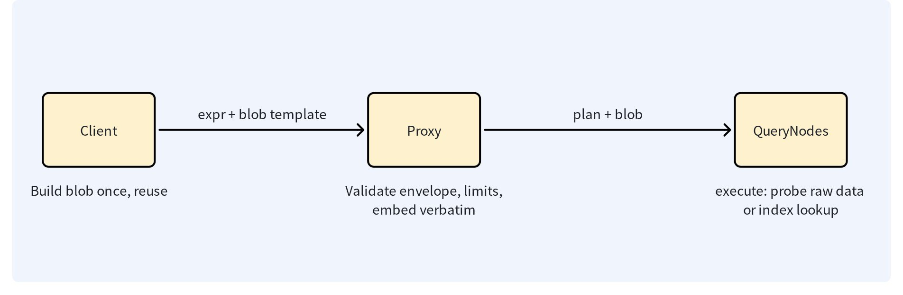

# Membership Match

## Overview

Membership-match filters entities by testing whether a scalar field value belongs to a caller-provided set. The client builds a compact binary membership-filter blob and passes it as an expression template value.

It replaces large `IN [...]` lists. An `IN` filter serializes every member into the request, so sufficiently large member sets can exceed the proxy gRPC receive limit. With `membership_match`, the proxy validates the blob and embeds it into the query plan without rebuilding a member list.



The diagram shows the fixed division of labor. The client builds the blob once and reuses it across requests; the proxy validates the envelope and size limits and embeds the blob into the query plan verbatim; and QueryNodes evaluate the plan against raw data or an index.

The operator has two encodings with different correctness guarantees:

- **Bloom** (`type=bloom`): Approximate membership. False positives are possible; false negatives are not expected from a valid filter. Typical use: high-volume audience or exclusion filters where occasional false positives are acceptable.
- **Roaring** (`type=roaring`): Exact membership for integer values. Typical use: ACLs, tenant visibility, compliance filters, and delete-by-ID-set operations.

Do not use **Bloom** membership for authorization decisions or destructive deletes. A false positive can expose an entity or delete an entity that is not in the intended set.

### Operational checklist

- Confirm the target field type and build the blob from that same value domain.
- Select Bloom only when false positives are acceptable.
- Select Roaring for ACL, compliance, tenant isolation, and delete operations.
- Build large blobs once and reuse them; do not rebuild them inside every request.
- Budget blob size in serialized bytes, not member count.
- On a mixed-version cluster, finish the rolling upgrade, proxies first, before enabling `membership_match`.
- Test the expression against a non-production collection before enabling a destructive workflow.

## Expression syntax

```text
membership_match(<field>, {<template>}, type=bloom)
membership_match(<field>, {<template>}, type=roaring)
membership_match(<field>, {<template>})
not membership_match(<field>, {<template>}, type=bloom)
```

The second argument is a template placeholder. The SDK supplies the placeholder value as protobuf `bytes` containing the client-built filter blob. Keep the `type` explicit in production expressions so the intended correctness contract is visible in code and logs.

The `type` argument is optional. Every blob carries a self-describing magic header, `MBF1` for Bloom and `MRB1` for Roaring, and the server sniffs the header when `type` is omitted. An explicit `type` that conflicts with the blob header is rejected as a request error, and unknown or truncated headers result in a fail-closed state.

## Choose the encoding

Use Bloom when a false positive is acceptable. Bloom accepts signed integer fields (**INT8**/**16**/**32**/**64**), **VARCHAR** fields, and **JSON** paths. A Bloom filter is not an exact allow-list.

`fpr` (false-positive rate) is the probability that a Bloom filter reports a value as a member when the value was never inserted: `fpr=0.005` means roughly one non-member value in 200 is wrongly reported as present. A lower fpr produces a larger blob.

Use **Roaring** when every match must be exact. **Roaring** accepts signed integer fields only; members are sign-extended to **INT64** before serialization, so an INT8 -1 and an INT64 -1 are the same member. Do not use it for UUID or other string fields.

| Dimension | Bloom (type=bloom) | Roaring (type=roaring) |
|-|-|-|
| Precision | Approximate; false positives possible; no false negatives | Exact; no false positives and no false negatives |
| Fields | INT8/16/32/64, VARCHAR, JSON paths | Signed INT8/16/32/64 only |
| Blob size | Member count and FPR; about 11 bits per member at FPR 0.005; power-of-two body | Value distribution; dense sets compress to far smaller sizes; random 64-bit values hit the 262,144 high-container cap |
| Delete | Rejected at parse time | Allowed |
| Typical use | Audience and exclusion filters | ACL, compliance, tenant isolation, delete by ID set |

**JSON** paths are strictly typed, row by row: a **JSON** string is probed as a **VARCHAR** value, a **JSON** integer as an **INT64** value, and a **JSON** double never matches an integer member, unlike the exact `IN`, where 5.0 equals 5. If your writers float-encode integers, normalize them on write or use a typed scalar field.

For either encoding, build the member set from the same value domain as the target field. Do not build a Bloom filter from the string `"10086"` and apply it to an `INT64` field. The blob header records the inserted value domains, and a wrong-domain blob is rejected by the proxy with a parameter error instead of silently matching nothing. Reuse a built blob across requests rather than rebuilding it for each query.

For sets of a few thousand members or fewer, plain `IN` remains the simplest option. The server does not choose between **IN**, **Bloom**, and **Roaring**. Selecting the encoding is the caller's responsibility.

To choose an encoding:

1. Determine whether the workload tolerates false positives. If it does not, **Bloom** is never an option.
2. For exact membership, use **Roaring** with a signed integer field. Dense or clustered values compress to the smallest blobs.
3. Check the size limits. Uniformly random 64-bit values may exceed the 262,144 high-container cap or the size limits. If they do, use a traditional **IN** list that fits the request limits.
4. For exact membership on non-integer fields, use **IN**. There is no exact membership encoding for these fields.

Membership-match is not available over the RESTful HTTP API. HTTP expression template parameters accept only bool, number, string, and array values; there is no binary `bytes` type for the blob. Use a gRPC-based SDK to pass membership blobs.

## SDK request patterns

The following snippets focus on building membership blobs and passing them as filter template parameters. They assume that the collections and fields already exist and are loaded, the SDK clients are connected, and query vectors, member lists, and other referenced variables are defined. Collection setup and complete application scaffolding are omitted.

<div class="multipleCode">
    <a href="#python">Python</a>
    <a href="#go">Go</a>
    <a href="#java">Java</a>
    <a href="#javascript">NodeJS</a>
</div>

```python
from pymilvus import MilvusClient, build_bloom_filter, build_roaring_bitmap

client = MilvusClient(uri="http://localhost:19530")
bloom_blob = build_bloom_filter(["creator-a", "creator-b"], fpr=0.005)
client.search(collection_name="posts", data=[query_vector], anns_field="embedding", limit=10,
              filter="membership_match(creator_id, {members}, type=bloom)",
              filter_params={"members": bloom_blob})

roaring_blob = build_roaring_bitmap([1001, 1002, 1003])
client.query(collection_name="docs", filter="membership_match(user_id, {members}, type=roaring)",
             filter_params={"members": roaring_blob}, output_fields=["user_id", "title"])
```

```go
bloomBlob, err := milvusclient.NewBloomFilterBlob([]int64{1001, 1002}, fpr)
if err != nil { return err }
search := milvusclient.NewSearchOption("posts", topK, vectors).
    WithFilter("membership_match(creator_id, {members}, type=bloom)").
    WithTemplateParam("members", bloomBlob)

roaringBlob, err := milvusclient.NewRoaringBitmapBlob([]int64{1001, 1002})
if err != nil { return err }
query := milvusclient.NewQueryOption("docs").
    WithFilter("membership_match(user_id, {members}, type=roaring)").
    WithTemplateParam("members", roaringBlob)
```

```java
byte[] bloomBlob = BloomFilterUtils.buildBloomFilter(userIds, BloomFilterUtils.DEFAULT_FPR);
QueryReq request = QueryReq.builder().collectionName("docs")
    .filter("membership_match(user_id, {members}, type=bloom)")
    .filterTemplateValues(Collections.singletonMap("members", bloomBlob)).build();
byte[] roaringBlob = RoaringBitmapUtils.buildRoaringBitmap(userIds);
```

```javascript
const bloomBlob = buildBloomFilter(userIds);
await client.query({ collection_name: 'docs',
  filter: 'membership_match(user_id, {members}, type=bloom)',
  exprValues: { members: bloomBlob } });
const roaringBlob = buildRoaringBitmap(integerIds);
```

## Delete with Roaring

Use an exact **Roaring** blob when deleting entities selected by an external integer-ID set. Review the member set and collection field type before issuing the delete. Do not use Bloom: approximate membership is not a safe delete predicate, and Bloom forms are rejected in Delete expressions at parse time.

<div class="multipleCode">
    <a href="#python">Python</a>
    <a href="#go">Go</a>
    <a href="#java">Java</a>
    <a href="#javascript">NodeJS</a>
</div>

```python
roaring_blob = build_roaring_bitmap([1001, 1002, 1003])
client.delete(collection_name="docs", filter="membership_match(id, {members}, type=roaring)",
              filter_params={"members": roaring_blob})
```

```go
roaringBlob, err := milvusclient.NewRoaringBitmapBlob([]int64{1001, 1002, 1003})
if err != nil { return err }
_, err = client.Delete(ctx, milvusclient.NewDeleteOption("docs").
    WithExpr("membership_match(id, {members}, type=roaring)").
    WithTemplateParam("members", roaringBlob))
```

```java
byte[] roaringBlob = RoaringBitmapUtils.buildRoaringBitmap(userIds);
DeleteReq request = DeleteReq.builder().collectionName("docs")
    .filter("membership_match(id, {members}, type=roaring)")
    .filterTemplateValues(Collections.singletonMap("members", roaringBlob)).build();
```

```javascript
const roaringBlob = buildRoaringBitmap(integerIds);
await client.delete({ collection_name: 'docs',
  filter: 'membership_match(id, {members}, type=roaring)',
  exprValues: { members: roaringBlob } });
```

Delete semantics follow exact, three-valued matching:

| Field value | membership_match(...) | not membership_match(...) |
|-|-|-|
| NULL | no match (NULL) | no match (NULL) |
| in member set | match | no match |
| outside the set | no match | match |

The table reads row by row: a Delete with `membership_match` removes the in-set entities, a Delete with `not membership_match` removes the outside-set entities, and NULL entities survive both polarities.

- Entities with a NULL field value are never deleted, under either polarity.
- An empty bitmap deletes nothing. `not membership_match(<field>, {<empty>}, type=roaring)` deletes every entity with a non-NULL field value, the exact complement, which may be a large set by design.
- `not membership_match` is the exact complement of the member set over non-NULL entities, not an approximation.

On sealed segments loaded index-only, without raw scalar data, evaluation uses a bounded reverse lookup when the index supports it. When neither raw field data nor a qualifying index is available, the request fails with `FieldNotLoaded` instead of returning unfiltered entities.

## Operational limits

| Setting | Default | Configurable | What it bounds |
|-|-|-|-|
| `proxy.maxMembershipFilterSize` | 64 MiB | `milvus.yaml` proxy | one blob body |
| `proxy.maxMembershipFilterPlanSize` | 128 MiB | `milvus.yaml` proxy | per-request aggregate |
| `proxy.grpc.serverMaxRecvSize` | 128 MiB | `milvus.yaml` proxy | whole request |
| Roaring high-container cap | 262,144 | fixed in code | per filter |
| Roaring decoded-memory estimate | 64 MiB | fixed in code | per filter |
| MBF1 format cap | 128 MiB | fixed in code | blob format ceiling |
| Bloom `fpr` | 0.005 | client builder | false-positive target |

The `proxy.*` settings are Milvus server configuration: they are set by the cluster operator in `milvus.yaml` under the `proxy` section and cannot be adjusted per request or per expression at filtering time. The **Roaring** admissions and the MBF1 format cap are fixed in the implementation and cannot be configured anywhere. The `fpr` row is the only client-side control: it is chosen when the blob is built, with an accepted range of 0.0001 to 0.05.

The blob body maximum admits about 48.6 million INT64 members at the default fpr, with the fixed 32-byte envelope header allowed on top. The request-wide budget covers the aggregate serialized size of membership-bearing plans plus the aggregate estimated decoded size of Roaring filters, and HybridSearch sub-requests and scorer filters share it. Bloom bodies are powers of two: a member count just past a tier boundary doubles the blob, and a slightly higher fpr often fits the next tier down. When the proxy rejects an oversized Bloom blob, the error suggests an `fpr` that fits.

- Membership expression results are not cached across requests.
- Mixed-version clusters fail closed: QueryNodes running older code reject plans that contain membership plan nodes. Upgrade the proxies first, then complete the rolling upgrade before enabling the operator.
- Server logs redact blob bytes. The expression text contains only the template name; the binary payload is transmitted out of band in the template values.
